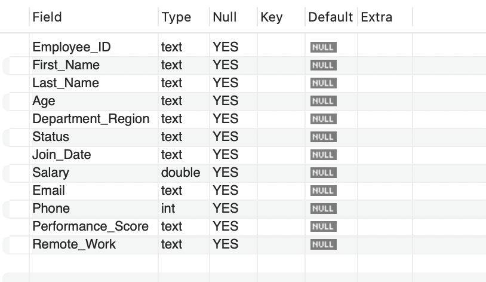
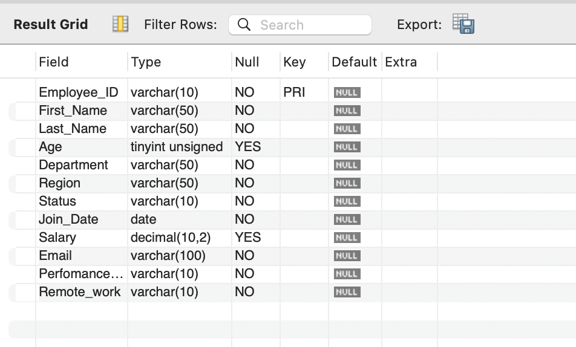
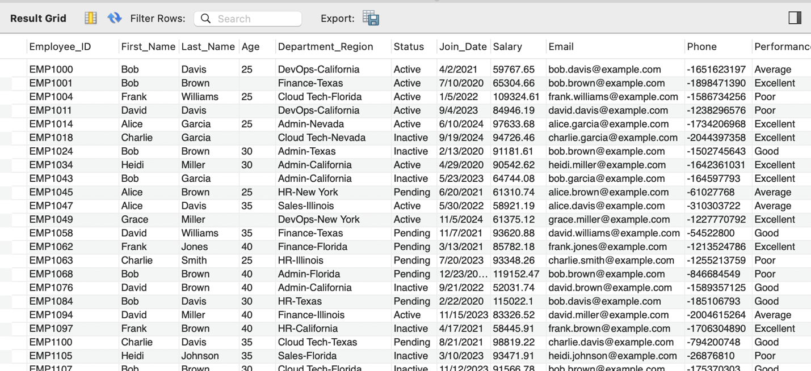
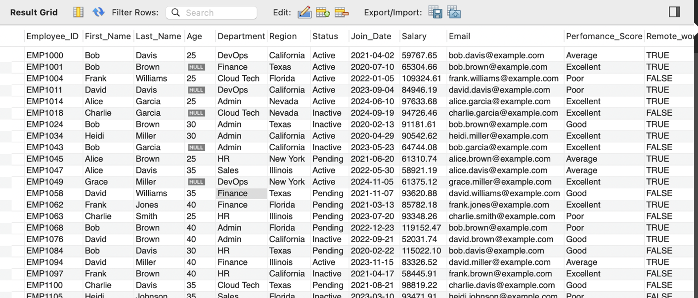

# Employee Data Cleaning with MySQL

Cleaning a messy 1,020-row employee dataset into an analysis-ready table using MySQL.

## Goal

Take a raw HR export with mixed data types, placeholder text and combined fields, and produce a typed, validated `employees` table that can be queried reliably.

## Source 
https://www.kaggle.com/datasets/desolution01/messy-employee-dataset

## Tools

MySQL Workbench

## How to run 
run script 01 Part A, import the CSV with the wizard, run Part B, then scripts 02 to 05
**NB:** Run the scripts in order.

## Dataset

`Messy_Employee_dataset.csv`: 1,020 rows, 12 columns (ID, name, age, department/region, status, join date, salary, email, phone, performance score, remote work).

## Project structure

| File | Purpose |
|------|---------|
| `01_setup_and_import.sql` | Create database, raw table, staging copy |
| `02_audit.sql` | Profile the data and record problems |
| `03_cleaning.sql` | Apply the fixes |
| `04_final_table.sql` | Build the typed `employees` table |
| `05_validation.sql` | Verify counts, NULLs and ranges |

## Issues found and fixes

| Column | Issue | Fix |
|--------|-------|-----|
| Salary | 24 rows contain text "N/A" | Converted to NULL, stored as DECIMAL(10,2) |
| Age | 211 blanks; only values 25/30/35/40 | Blanks to NULL, kept as approximate |
| Join_Date | Text, M/D/YYYY with no zero-padding | `STR_TO_DATE(..., '%m/%d/%Y')` into a DATE column |
| Department_Region | Two values in one field | Split into `department` and `region` |
| Phone | All 1,020 values are negative numbers | Excluded from the final table |
| Email | 956 repeated values | Kept; not used as an identifier |

## Checked and found clean

Duplicate IDs, duplicate rows, whitespace, casing, status and performance values, salary range, join-date range.

## Before and after

**Before (raw)**

**After (cleaned)**

## Department_Region and Phone

**Before (raw)**

**After (cleaned)**

## Judgement calls

1. **Left Age as NULL instead of imputing.** About a fifth is missing and the existing values are only four bands, so any fill-in would be invented data.
2. **Dropped Phone.** Every value is a negative integer, so the real numbers cannot be recovered. Stripping the minus sign would create fake numbers.
3. **Did not de-duplicate on email.** Only 8 first and 8 last names exist, so repeated emails are different employees. `Employee_ID` is the real key.
4. **Imported everything as VARCHAR first.** This stops blanks, "N/A" and large phone values from failing the import.
5. **Kept the raw table untouched.** Cleaning happens in a copy so every change can be audited.
6. **Left Salary NULLs in place.** `AVG()` ignores NULLs, so analysis stays correct without guessing.

## What I learned

Not every problem is fixable. Part of cleaning is deciding what to repair, what to leave honest as NULL, and what to remove and explain.
